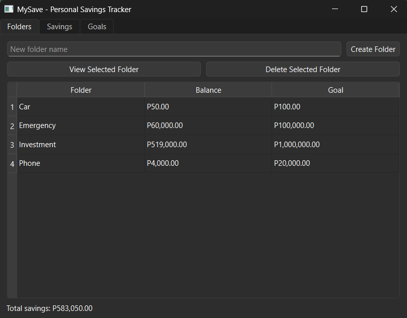
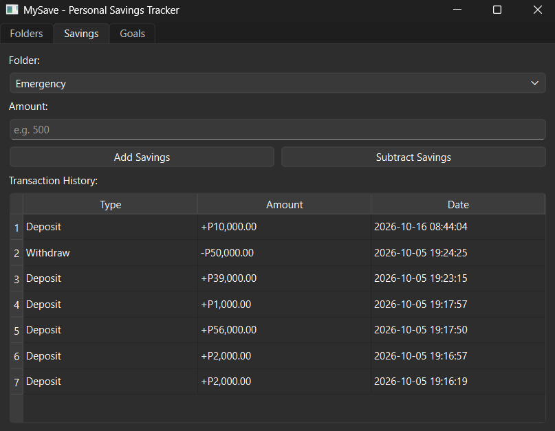
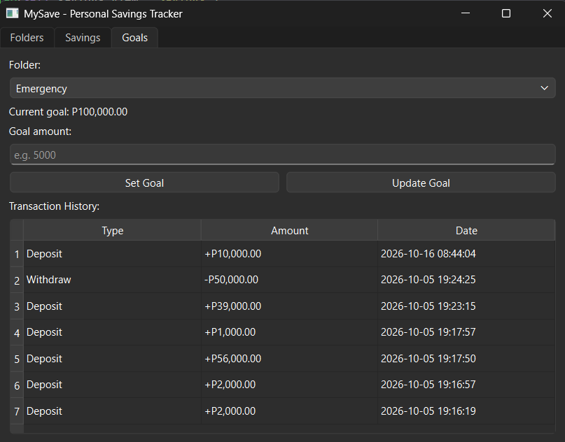

## 1. Project Title

**MySAVE: A Personal Savings Tracker**


## 2. Project Description

**What the System Does** 
MySAVE is a personal savings tracking system developed as a desktop GUI application. It allows users to encode and specifically separate their savings into different folders such as Emergency, Investment, or other personal goal. The system keeps track of the current balance and goal amount for each folder. It also records savings transactions in an SQLite database.

**Problem or Need Addressed** 
Managing savings manually like writing or putting it into the 'note' application on phones can make it difficult to keep track of different financial goals and current balances. MySAVE provides a simple way to organize savings and monitor progress in one application. This helps people to track their saving funds and keeps them motivated when seeing their progress over time.


## 3. Project Objectives

The main objectives of MySAVE are:

- To provide a simple system for managing personal savings.
- To allow users to create and manage different savings folders.
- To record deposits and withdrawals.
- To set and update saving goals.
- To automatically calculate and display the total savings.
- To store savings information using a database.
- To demonstrate Object-Oriented Programming and CRUD/database concepts.


## 4. Features

**Savings Folder Management**
- Create a new savings folder.
- View all existing savings folders.
- View the balance of a selected folder.
- Delete a folder when its balance is zero.
- Display the current balance and goal of each folder.
- Display the total savings from all folders.

**Savings Management**
- Select a savings folder.
- Add/deposit money into a folder.
- Subtract/withdraw money from a folder.
- Prevent withdrawals that are greater than the current balance.
- Validate that the entered amount is a valid positive number.
- View the transaction history of the selected folder (type, amount, and date), newest first.

**Goal Management**
- Select a savings folder.
- Set a savings goal.
- Update an existing savings goal.
- Display the current goal of the selected folder.
- View the transaction history of the selected folder, the same table shown in the `Savings` tab.


## 5. Technologies Used

**Programming Language**
- Python 3.14.7

**GUI Framework**
- PyQt6

**Database**
- SQLite3

**Other Libraries / Tools**
- `sqlite3` 
- `pathlib` 
- `dataclasses`
- `math` 
- `sys` 
- Visual Studio Code
- Git/Github
- Python virtual environment


## 6. Project Structure

```text
mySAVE/
│
├── main.py
│
├── database/
│   ├── database.py
│   └── savings.db
│
└── features/
    ├── helpers.py
    │
    ├── SavingsFolderManagement/
    │   ├── model.py
    │   ├── repository.py
    │   ├── service.py
    │   └── view.py
    │
    ├── SavingsManagement/
    │   ├── model.py
    │   ├── repository.py
    │   ├── service.py
    │   └── view.py
    │
    └── GoalManagement/
        ├── model.py
        ├── repository.py
        ├── service.py
        └── view.py
```


### Important Files and Folders

| File/Folder | Purpose |
|---|---|
| `main.py` | Starts the application and creates the main window and tabs. |
| `database/database.py` | Creates the SQLite connection and database tables. |
| `database/savings.db` | SQLite database containing the saved application data. |
| `features/helpers.py` | Contains helper functions such as amount/input validation. |
| `SavingsFolderManagement/model.py` | Defines the savings folder data model. |
| `SavingsFolderManagement/repository.py` | Handles database operations for savings folders. |
| `SavingsFolderManagement/service.py` | Contains the business logic for savings folders. |
| `SavingsFolderManagement/view.py` | Provides the GUI for creating, viewing, and deleting folders. |
| `SavingsManagement/model.py` | Defines the savings transaction model. |
| `SavingsManagement/repository.py` | Handles savings transaction database operations, including reading the transaction history. |
| `SavingsManagement/service.py` | Handles deposit and withdrawal logic. |
| `SavingsManagement/view.py` | Provides the GUI for adding and subtracting savings and showing the transaction history. |
| `GoalManagement/model.py` | Defines the savings goal model. |
| `GoalManagement/repository.py` | Handles database operations for goals. |
| `GoalManagement/service.py` | Handles setting and updating savings goals. |
| `GoalManagement/view.py` | Provides the GUI for managing goals and showing the transaction history. |


## 7. Installation and Setup

**Requirements**
- Python 3.14.7
- PyQt6
- Visual Studio Code or another Python IDE

**Step 1: Clone the Repository**
Open a terminal and run:
```bash
git clone https://github.com/Jsupp-org/mySAVE.git
```
Then enter the project folder:
```bash
cd mySAVE
```

**Step 2: Open the Project**
Open the `mySAVE` folder in Visual Studio Code.

**Step 3: Create a Virtual Environment**
Open the VS Code terminal and run:
```bash
python -m venv .venv
```
Activate the virtual environment on Windows:
```bash
.venv\Scripts\activate
```

**Step 4: Install PyQt6**
Run:
```bash
pip install PyQt6
```

**Step 5: Run the Application**
Make sure the terminal is inside the project folder, then run:
```bash
python main.py
```

   
## 8. How to Use the System

**A. Create a Savings Folder**

1. Open the `Folders` tab.
2. Enter a folder name in the `New folder name` field.
3. Click `Create Folder`.
4. The new folder will appear in the table.

**B. View a Folder**

1. Go to the `Folders` tab.
2. Select a folder from the table. (The `Create Folder`, `View Selected Folder`, and `Delete Selected Folder` buttons are at the top of the tab.)
3. Click `View Selected Folder`.
4. The application displays the folder's current balance.

**C. Add Savings**

1. Open the `Savings` tab.
2. Select a folder.
3. Enter the amount.
4. Click `Add Savings`.
5. The folder's current balance will increase.

**D. Subtract Savings**

1. Open the *`Savings` tab.
2. Select a folder.
3. Enter the amount.
4. Click `Subtract Savings`.
5. The amount will be removed from the folder if sufficient balance is available. (The system prevents the user from withdrawing more money than the folder contains.)

**E. Set a Goal**

1. Open the `Goals` tab.
2. Select a folder.
3. Enter the target amount.
4. Click `Set Goal`.

**F. Update a Goal**

1. Open the `Goals` tab.
2. Select a folder that already has a goal.
3. Enter the new target amount.
4. Click `Update Goal`.

**G. View the Transaction History**

1. Open the `Savings` tab or the `Goals` tab.
2. Select a folder.
3. The `Transaction History` table below the buttons lists that folder's deposits and withdrawals, newest first.
4. The table updates automatically after every deposit or withdrawal, and it changes when a different folder is selected.


## 9. OOP Implementation

MySAVE uses Object-Oriented Programming throughout the application.

**Important Classes**

- `Database`
- `SavingsFolderModel`
- `SavingsFolderRepository`
- `SavingsFolderService`
- `SavingsFolderView`
- `SavingsModel`
- `SavingsRepository`
- `SavingsService`  
- `SavingsView`
- `GoalModel`
- `GoalRepository`
- `GoalService`
- `GoalView`
- `MainWindow`

**Encapsulation**

Encapsulation is applied by organizing data and related operations inside classes.

For example, `SavingsFolderService` handles the operations related to savings folders, while `SavingsFolderRepository` handles the database operations.

The views also communicate with service classes instead of directly performing all database operations.

**Inheritance**

PyQt6 classes are inherited to create the application's GUI components.

Examples:

```python
class MainWindow(QMainWindow):
```

and

```python
class SavingsView(QWidget):
```

The custom classes inherit functionality from PyQt6's `QMainWindow` and `QWidget`.

**Polymorphism**

The project does not use a large custom inheritance hierarchy requiring explicit method overriding. However, the GUI classes use PyQt6's inherited widget behavior and Qt's signal/slot system to respond to user actions.


## 10. Database

**Database Structure**

| Item | Description |
|---|---|
| Database file | `database/savings.db` |
| Database engine | SQLite3, accessed with Python's built-in `sqlite3` module. |
| Created by | `Database.create_table()` in `database/database.py`, which runs every time the application starts. |
| Number of tables | 2 |

**Important Tables**

| Table | Purpose |
|---|---|
| `savings_folders` | Stores each savings folder, its savings goal, and its current balance. |
| `savings_transac` | Stores every deposit and withdrawal. This is the transaction history shown in the `Savings` and `Goals` tabs. |

**`savings_folders` Table**

| Column | Type | Description |
|---|---|---|
| `id` | INTEGER, primary key, auto increment | Unique ID of the folder. |
| `name` | TEXT, not null, unique | Name of the folder. Two folders cannot have the same name. |
| `goal_amount` | REAL, not null, default 0 | Savings goal of the folder. A value of 0 means no goal has been set. |
| `current_amount` | REAL, not null, default 0 | Current balance of the folder. |
| `create_at` | TEXT, not null, default current date and time | When the folder was created. |

**`savings_transac` Table**

| Column | Type | Description |
|---|---|---|
| `id` | INTEGER, primary key, auto increment | Unique ID of the transaction. |
| `folder_id` | INTEGER, not null, foreign key | The folder that owns the transaction (`savings_folders.id`). |
| `transaction_type` | TEXT, not null | Either `deposit` or `withdraw` (enforced by a `CHECK` constraint). |
| `amount` | REAL, not null | Amount of the transaction. It must be greater than 0 (enforced by a `CHECK` constraint). |
| `note` | TEXT | Optional note. It is not currently used by the GUI. |
| `create_at` | TEXT, not null, default current date and time | When the transaction was recorded. |

**Date and Time**

| Item | Description |
|---|---|
| Stored as | SQLite saves `create_at` in UTC. |
| Shown as | The transaction history tables convert it to the computer's local time with `datetime(create_at, 'localtime')`. |

**Relationship**

| Parent Table | Child Table | Relationship | Foreign Key | On Delete |
|---|---|---|---|---|
| `savings_folders` | `savings_transac` | One folder has many transactions. | `savings_transac.folder_id` references `savings_folders.id` | `CASCADE` |

`ON DELETE CASCADE` means that deleting a folder also deletes its transactions. The application only allows a folder to be deleted when its balance is zero.

**CRUD Operations**

| Operation | Feature | SQL Used | Description |
|---|---|---|---|
| Create | Create Folder | `INSERT INTO savings_folders` | Adds a new folder with a balance of P0.00 and no goal. |
| Create | Add / Subtract Savings | `INSERT INTO savings_transac` | Records each deposit or withdrawal. |
| Read | View Folders | `SELECT id, name, goal_amount, current_amount FROM savings_folders` | Reads the folders shown in the `Folders` tab and used for the total savings. |
| Read | Transaction History | `SELECT ... FROM savings_transac WHERE folder_id = ? ORDER BY id DESC` | Reads the selected folder's transactions, newest first, for the `Savings` and `Goals` tabs. |
| Update | Add / Subtract Savings | `UPDATE savings_folders SET current_amount = current_amount + ? WHERE id = ?` | Changes the folder's balance after a deposit or withdrawal. |
| Update | Set / Update Goal | `UPDATE savings_folders SET goal_amount = ? WHERE id = ?` | Changes the folder's goal. |
| Delete | Delete Folder | `DELETE FROM savings_folders WHERE id = ?` | Deletes a folder. This is only allowed when its balance is zero. |
| Search / Find | All features | `SELECT id, current_amount FROM savings_folders WHERE name = ?` | Finds a folder by its name before the system acts on it. |


## 11. Screenshots

**Screenshots**

*Folders Tab*
    Shows the folder buttons at the top, followed by the list of savings folders, balances, goals, and total savings.




*Savings Tab*   
    Shows the controls for adding and subtracting savings, and the transaction history of the selected folder.




*Goals Tab*
    Shows the controls for setting and updating savings goals, and the transaction history of the selected folder.




## 12. Testing

The system was tested using different inputs to check its major features and validation rules.

|                Test             |               Input / Action              |                       Expected Result                        |
|---------------------------------|-------------------------------------------|--------------------------------------------------------------|
| Create folder                   |   Create `Emergency`                      |    Folder is created and displayed.                          |
| Duplicate folder                |   Create another `Emergency`              |    System displays an error because the name already exists. |
| Empty folder name               |   Leave the folder name empty             |    System displays an error.                                 |
| Add savings                     |   Add `2000` to a folder                  |    Balance increases by `P2,000.00`.                         |
| Withdraw savings                |   Withdraw `500`                          |    Balance decreases by `P500.00`.                           |
| Excess withdrawal               |   Withdraw more than the current balance  |    System displays an insufficient balance error.            |
| Invalid amount                  |   Enter text such as `abc`                |    System displays an invalid input error.                   |
| Negative amount                 |   Enter a negative amount                 |    System rejects the transaction.                           |
| Set goal                        |   Set a goal such as `100000`             |    Goal is saved for the selected folder.                    |
| Update goal                     |   Change an existing goal                 |    Goal is updated.                                          |
| Delete folder with zero balance |   Delete a folder with `P0.00`            |    Folder is deleted.                                        |
| Delete folder with balance      |   Delete a folder containing savings      |    System prevents deletion.                                 |
| Total savings                   |   Create/update several folders           |    Total savings is recalculated and displayed.              |
| View transaction history        |   Select a folder in the `Savings` tab    |    The folder's deposits and withdrawals are listed, newest first, with type, amount, and date. |
| Transaction history in `Goals` tab |   Select a folder in the `Goals` tab   |    The same transaction history as the `Savings` tab is shown. |
| Switch folders                  |   Select a different folder               |    The transaction history changes to the selected folder's transactions. |
| History updates after saving    |   Add or subtract savings                 |    The new transaction appears at the top of the history in both tabs. |

**Example Database Test**

A sample database state can contain folders such as:

Car
Motor
Emergency
Investment

Each folder stores its own goal and current balance, while deposits and withdrawals are stored in the transaction table.


## 13. Known Issues / Limitations

- The application is currently designed as a local desktop application.
- It does not have user accounts or login functionality.
- There is no online/cloud synchronization.
- The transaction history shows one folder at a time. There is no combined view of all folders and no date filter.
- The transaction `note` field exists in the database but is not currently exposed through the GUI.
- The application does not provide charts or graphs for savings progress.
- The application does not automatically calculate a recommended amount to save per day or month.
- The system uses a simple folder-name search rather than a separate search screen.
- The database is stored locally on the computer.


## 14. Author

**Name:** Jasper B. Indil

**Section:** 3581
